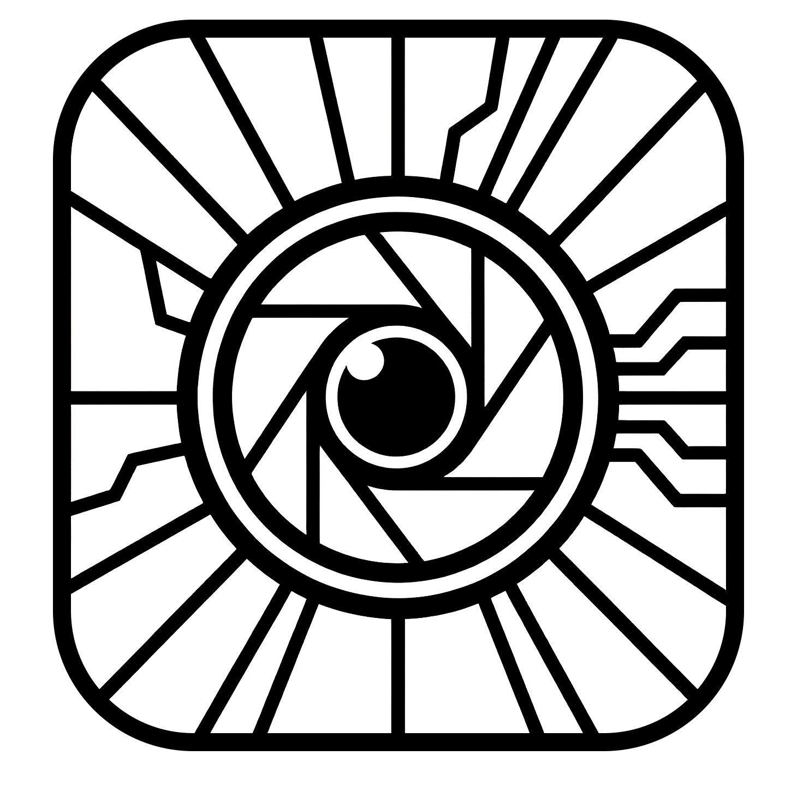

<div align="center">

 <h1> 
 <br/>
 Flaresim AE</h1>

  
 <br>
  
  


</div>
<br/>


After Effects port of FlareSim.

A CUDA-accelerated Aftereffects plugin for physically-based lens flare simulation. FlareSim traces rays through a real lens prescription to produce ghost reflections that respond correctly to source position, wavelength, and aperture shape — without look-up textures or artist-painted elements.

> [!IMPORTANT]
> This is mostly for personal exploration and NOT production tested or stable.

## Supported versions: 

AfterEffects 25.5 Windows + CUDA first.

## Plugin Settings

The UI is grouped to match the render pipeline: camera setup, aperture shaping, flare/source extraction, then reconstruction and post work.
Defaults below match the current plugin build.

### Lens

| Setting | Values / range | Default | Notes |
| --- | --- | --- | --- |
| Manufacturer | Bundled manufacturer popup | default bundle selection | Chooses a bundled preset family. |
| Lens | Manufacturer-specific popup | `double-gauss` | Chooses the actual lens prescription used for ray tracing. |

Notes:
- lens options come from the bundled `space55` and `flaresim_nuke` preset manifests
- the hidden `Legacy Lens` popup still exists for old saved comps; new work should use `Manufacturer` + `Lens`

### Camera

| Setting | Values / range | Default | Notes |
| --- | --- | --- | --- |
| Use Sensor Size | `Off`, `On` | `Off` | `Off`: use FOV controls. `On`: derive FOV from sensor size + focal length. |
| Sensor Preset | `Custom`, `Full Frame`, `Super 35`, `APS-C Canon`, `APS-C Nikon/Sony`, `Micro Four Thirds` | `Custom` | Preset sizes override width/height when not `Custom`. |
| FOV H (deg) | slider `1`-`180`; manual higher precision | `40` | Horizontal field of view when `Use Sensor Size` is off. |
| Auto FOV V | `Off`, `On` | `On` | When on, vertical FOV follows comp aspect ratio. |
| FOV V (deg) | slider `1`-`180` | `24` | Used only when `Auto FOV V` is off. |
| Sensor Width (mm) | slider `1`-`100` | `36` | Used when `Use Sensor Size` is on and preset is `Custom`. |
| Sensor Height (mm) | slider `1`-`100` | `24` | Used when `Use Sensor Size` is on and preset is `Custom`. |
| Focal Length (mm) | slider `1`-`200` | `50` | Used with sensor-size camera mode. |
| Anamorphic Squeeze | slider `1`-`4`; manual values allowed above slider max | `1` | Horizontally desqueezes ghost projection. `2` approximates a 2x anamorphic look; this does not add proprietary cylindrical lens prescriptions. |

### Aperture

| Setting | Values / range | Default | Notes |
| --- | --- | --- | --- |
| Aperture Blades | `0`-`16` | `0` | `0` keeps the lens/aperture path effectively round. Higher values force polygonal aperture shaping. |
| Aperture Rotation | slider `-180` to `180` deg | `0` | Rotates polygonal aperture and starburst orientation. |

### Flare Settings

| Setting | Values / range | Default | Notes |
| --- | --- | --- | --- |
| Adaptive Sampling | `Disabled`, `Enabled` | `Disabled` | Enables projected-cell reconstruction. Faster than brute-force grid increases, but more stylized/experimental. |
| Adaptive Quality | slider `0.25`-`2` | `1` | Scales adaptive per-pair ray grids. Lower values bound complex-lens render spikes; `1` keeps the `Ray Grid` baseline. |
| Flare Gain | slider `0`-`5000`; manual values allowed above slider max | `4000` | Global flare brightness multiplier. |
| Sky Brightness | slider `0`-`4`; manual higher values allowed | `1` | Scales sub-threshold scene values before source extraction. |
| Threshold | slider `0`-`64` | `8` | Bright-pixel cutoff for source detection. Lower = more sources/noise. |
| Source Cap | slider `0`-`64`; manual higher values allowed | `0` | Clamps individual source luminance before thresholding and flare contribution. `0` disables the cap. |
| Manual Source | `Off`, `On` | `Off` | Adds one artist-placed source in addition to detected HDR sources. |
| Source X / Source Y | slider `-1`-`2`; manual values allowed outside slider range | `0.5`, `0.5` | Manual source position in normalized frame space. `0..1` is on-frame; outside values create offscreen sources. |
| Source Intensity | slider `0`-`256`; manual higher values allowed | `16` | Manual source brightness. |
| Source Red / Green / Blue | slider `0`-`4`; manual higher values allowed | `1`, `1`, `1` | Manual source color multipliers. |
| Ray Grid | `1`-`2048` | `128` | Base ray density for ghost tracing. Main quality/perf lever. |
| Downsample | `1`-`12` | `2` | Source extraction block size. Higher = faster, fewer detected highlights. |
| Max Sources | `0`-`2048` | `256` | `0` means unlimited. Otherwise keeps only the brightest detected sources. |
| Cluster Radius | `0`-`256` | `0` | Merges nearby detected sources before ghost tracing. `0` disables clustering. |
| Preview Mode | `Off`, `On` | `Off` | Overrides quality controls below for faster interactive previews. |
| Preview Ray Grid | `1`-`128` | `16` | Ray grid used while Preview Mode is on. |
| Preview Max Sources | `0`-`512` | `100` | Source cap used while Preview Mode is on. |
| Preview Downsample | `1`-`24` | `8` | Source extraction stride used while Preview Mode is on. |
| Preview Spectral Samples | `3`, `5`, `7`, `9`, `11`, `15`, `21`, `31` | `3` | Spectral sample count used while Preview Mode is on. |

### Post-processing

| Setting | Values / range | Default | Notes |
| --- | --- | --- | --- |
| Ghost Blur | slider `0`-`0.05` | `0.0005` | Blur radius as a fraction of image diagonal. |
| Ghost Blur Passes | `0`-`8` | `3` | Extra blur passes for the ghost layer. |
| Haze Gain | slider `0`-`10` | `0` | Enables soft glow from extracted sources. `0` disables haze. |
| Haze Radius | slider `0`-`0.5` | `0.15` | Haze blur radius as a fraction of image diagonal. |
| Haze Blur Passes | `0`-`8` | `3` | Additional haze blur passes. |
| Starburst Gain | slider `0`-`10` | `0` | Enables diffraction-style starburst. `0` disables starburst. |
| Starburst Scale | slider `0`-`0.5` | `0.15` | Starburst size. Shape follows aperture blades/rotation. |
| Spectral Samples | `3`, `5`, `7`, `9`, `11`, `15`, `21`, `31` | `3` | Wavelength samples per ghost trace. Higher = better dispersion/color, slower render. |
| Spectral Jitter | `Off`, `Stratified`, `Halton` | `Off` | Jitters expanded-spectrum wavelength bins to reduce banding in high-dispersion renders. Applies when spectral samples are above 3. |
| Spectral Seed | `0`-`1000000` | `0` | Seed for spectral jitter. |
| Ghost Cleanup | `Legacy Blur`, `Sharp Adaptive`, `Sharp + Blur` | `Sharp Adaptive` | Reconstruction mode for ghost artifacts. `Legacy Blur`: old soft cleanup. `Sharp Adaptive`: sharper footprint-based reconstruction. `Sharp + Blur`: sharp reconstruction plus post blur. |

Notes:
- `Ghost Blur` is only applied in `Legacy Blur` and `Sharp + Blur`
- haze and starburst are generated from extracted sources, not from the traced ghost buffer

### Advanced Ghosts

These only matter when chasing ghost artifacts/perf tradeoffs. Most shots should stay near defaults.

| Setting | Values / range | Default | Notes |
| --- | --- | --- | --- |
| Adaptive Strength | slider `0`-`2` | `0` | Strength of adaptive pair-grid scaling. Higher spends more rays on large/high-warp pairs. |
| Footprint Bias | slider `0.25`-`2` | `1` | Multiplier for adaptive splat footprint radius. Lower = sharper/riskier. Higher = smoother/softer. |
| Footprint Clamp | slider `0.5`-`4` | `1.15` | Caps adaptive footprint expansion. Prevents extremely wide splats. |
| Max Pair Grid | `0`-`512` | `0` | `0` keeps automatic limits. Non-zero hard-caps adaptive per-pair ray grids. |
| Pair Start | `0`-`512` | `0` | Skips this many active ghost pairs after physical filtering. |
| Pair Count | `0`-`512` | `0` | Limits active ghost pairs after `Pair Start`. `0` keeps all remaining pairs. |
| Surface Start | `0`-`512` | `0` | First lens surface receiving the Surface Gain art override. |
| Surface Count | `0`-`512` | `0` | Number of surfaces to affect. `0` affects all surfaces from Surface Start onward. |
| Surface Gain | slider `0`-`4`; manual higher values allowed | `1` | Multiplies selected surface reflectance before ghost tracing. `0` suppresses selected reflective surfaces; values above `1` exaggerate them. |
| Pupil Jitter | `Off`, `Stratified`, `Halton` | `Off` | Entrance-pupil sampling pattern. Stratified and Halton break up regular grid dots. |
| Jitter Seed | `0`-`1000000` | `0` | Fixed seed for Stratified jitter when `Auto Seed` is off. |
| Auto Seed | `Off`, `On` | `On` | Uses the current frame as the Stratified jitter seed for animated noise variation. |
| Cell Coverage | slider `0.5`-`2.5` | `1` | Expands or contracts projected-cell coverage. Higher can fill missing lobes; too high can bloat shapes. |
| Cell Edge Inset | slider `0`-`0.45` | `0.1` | Pulls risky cell corners inward near aperture boundaries. Higher can stabilize edge cells but may introduce gaps. |

Guidance:
- grid/lattice artifacts first: try `Ghost Cleanup = Sharp Adaptive`, then raise `Ray Grid`
- complex-lens stalls: lower `Adaptive Quality` before lowering `Ray Grid`
- interactive setup: enable `Preview Mode`; brightness is compensated for preview downsample changes, not for a lower preview source cap
- over-smooth ghosts: lower `Footprint Bias` a bit before touching `Ghost Blur`
- missing projected-cell coverage: raise `Cell Coverage` slightly, then adjust `Cell Edge Inset`
- perf spikes in hard shots: keep `Adaptive Sampling` disabled, or cap `Max Pair Grid`
- pair isolation: raise `Pair Start`, then set `Pair Count = 1` to inspect one active pair at a time

### View + AE-only controls

| Setting | Values / range | Default | Notes |
| --- | --- | --- | --- |
| View | `Composite`, `Flare Only`, `Bloom Only`, `Sources`, `Diagnostics` | `Composite` | Debug/output selection inside After Effects. |
| Mask Layer | AE layer selector | none | Limits source detection to the chosen layer's visible content in comp space while flare/haze/starburst still render across the full frame. |

Mask Layer behavior:
- only affects source detection
- does not crop or matte the generated flare, haze, or starburst
- uses the selected layer's visible pixels as the detection mask: `max(R,G,B) * alpha`
- evaluated in full comp space so the chosen layer can be smaller than frame size
- practical use: isolate which tracked highlights emit flares without cutting off the flare itself


## Photoshop filter

`FlareSimPS.8bf` is a Filter-menu plug-in (`Filter > FlareSim > FlareSim...`) built on the same runtime as the AE effect, so the same settings give the same render.
Built and tested against Photoshop 2026 (27.6) on Windows, with CUDA when available and the CPU/OpenMP fallback otherwise.

- RGB documents in 8, 16 and **32 bits per channel**. 32-bit documents are linear HDR: source detection sees real scene values and the result keeps over-range values (`allowOverrangeColors`), so use 32-bit when `Threshold` should mean what it says. 8/16-bit values are 0..1, so detection needs a threshold below 1 there.
- The whole document is the camera frame. A selection limits where the flare is written, not where sources are detected or where ghosts land.
- Works as a Smart Filter; double-click it to re-open the dialog with its stored settings.
- On a layer with transparency, colour is premultiplied for the render and written back as straight alpha. With `Manual Source` on, the filter draws a flare onto an empty layer.
- The dialog has a live preview (fit, half or full resolution). Click or drag in the preview to place the manual source; positions outside the image give off-frame sources.
- All controls from the AE effect except `Mask Layer` and `Auto Seed` (Photoshop has no layers-as-parameters or timeline). `View` is available, so `Flare Only` can render the flare onto its own layer.

Install with `scripts/install_ps_plugin.ps1` (copies the plug-in, `cudart64_12.dll` and `assets/lenses` into `<Photoshop>\Plug-ins\FlareSim\`), then restart Photoshop.

Scripting and actions: the filter's event is `stringIDToTypeID("flareSimPS")` with one text key `FsSt` holding `flaresim-ps 1` followed by `key=value` lines. The keys (`lens`, `flare_gain`, `ray_grid`, `view`, ...) are listed in `src/ps/ps_settings.cpp`; popups take their label text. Missing keys use defaults, never the last-used settings, so a script renders the same every time.

```js
var desc = new ActionDescriptor();
desc.putString(charIDToTypeID("FsSt"), "flaresim-ps 1\nlens=double-gauss\nflare_gain=2000\nview=Flare Only\n");
executeAction(stringIDToTypeID("flareSimPS"), desc, DialogModes.NO);
```

## License

Unless noted otherwise, original project material in this repository is licensed under the
custom `Flaresim AE Licence`, a modified
[Creative Commons Attribution-NonCommercial-ShareAlike 4.0 International](https://creativecommons.org/licenses/by-nc-sa/4.0/)
licence with additional terms. See [LICENSE](LICENSE).

Bundled third-party material and imported upstream lens data keep their respective upstream notices/licenses and are not relicensed by this top-level notice.
